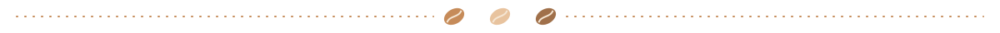
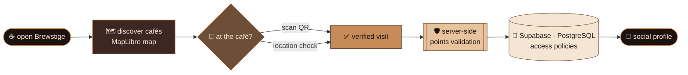

<a name="top"></a>
<!-- ═══════════════════════════════════════════════════════════════════════
     rjyot · profile README · espresso edition
     palette: #1C1210 espresso · #3E2723 roast · #6F4E37 mocha · #C68B59 amber · #E8C39E latte · #F5E6D3 cream
     ═══════════════════════════════════════════════════════════════════════ -->


<picture>
  <source media="(prefers-color-scheme: dark)" srcset="./assets/brew-terminal-dark.svg" />
  <source media="(prefers-color-scheme: light)" srcset="./assets/brew-terminal-light.svg" />
  
</picture>

<p align="center">
  
</p>

<p align="center">
  
  
  
  <br />
  
  
</p>

<p align="center">
  <a href="https://www.linkedin.com/in/ryanjyothis/"></a>
  &nbsp;
  
  &nbsp;
  
</p>



<!-- ═════════════════════════ Nº 01 · THE ORDER TICKET ═════════════════════════ -->

<h2 align="center">〔 Nº 01 〕 &nbsp; T H E &nbsp; O R D E R &nbsp; T I C K E T</h2>
<p align="center"><sub><i>one ryan, extra hot, no fluff</i></sub></p>

```yaml
# ticket: rjyot  ·  table: Belfast, Northern Ireland
order:
  name:        Ryan Jyothis
  studying:    Software Engineering (integrated master's) @ Queen's University Belfast
  placement:   Citi
  brewing:     Brewstige  # private · in development
  stack:       [TypeScript, React, React Native, Expo, Supabase, PostgreSQL, MapLibre]
  looking_for:
    - summer 2027 software engineering internships
    - UK & Ireland
  extras:      maximal
```


<!-- ═════════════════════════ Nº 02 · HOUSE SPECIAL ═════════════════════════ -->

<h2 align="center">〔 Nº 02 〕 &nbsp; H O U S E &nbsp; S P E C I A L</h2>

<table>
<tr>
<td width="58%" valign="top">

<h3>☕ BREWSTIGE</h3>


> **A better way to find your next café in Belfast.**

A mobile app bringing **café discovery**, **verified visits** and **social profiles** together in one place.

It's the project where I get to work across the whole stack: interactive maps, QR and location-based check-ins, server-side points validation, database access policies and native Android builds.

<!-- TODO-CONFIRM (Ryan): Jovan's README lists Brewstige as 2nd overall at Hack Belfast (24-hour hackathon, 5-person team). Confirm before showing anything like:
      -->

</td>
<td width="42%" valign="top">

| ☕ &nbsp; on the cup | |
|:--|:--|
| **Type** | Mobile app |
| **City** | Belfast |
| **Status** | Private · in development |
| **App** | React Native · Expo · Expo Router |
| **Styling** | NativeWind |
| **Language** | TypeScript |
| **Backend** | Supabase · PostgreSQL |
| **Maps** | MapLibre |
| **Builds** | Native Android |

</td>
</tr>
</table>



<details>
<summary><b>🗺️ &nbsp; shot 1 · interactive maps</b></summary>
<br />

| Ingredient | Notes |
|:--|:--|
| Library | MapLibre |
| Job | Café discovery on an interactive map |
| Lives in | React Native · Expo |

</details>

<details>
<summary><b>📍 &nbsp; shot 2 · QR + location check-ins</b></summary>
<br />

| Ingredient | Notes |
|:--|:--|
| Methods | QR codes and location-based check-ins |
| Job | Turning a café visit into a verified visit |
| Lives in | React Native · Expo |

</details>

<details>
<summary><b>🛡️ &nbsp; shot 3 · server-side points validation</b></summary>
<br />

| Ingredient | Notes |
|:--|:--|
| Where | Server side, not on the device |
| Job | Validating points before they count |
| Backed by | Supabase · PostgreSQL |

</details>

<details>
<summary><b>🔐 &nbsp; shot 4 · database access policies</b></summary>
<br />

| Ingredient | Notes |
|:--|:--|
| Where | Supabase · PostgreSQL |
| Job | Access policies on the data behind visits and profiles |

</details>

<details>
<summary><b>🤖 &nbsp; shot 5 · native Android builds</b></summary>
<br />

| Ingredient | Notes |
|:--|:--|
| Platform | Android |
| Toolchain | Expo · React Native |
| Job | Native builds of the app |

</details>


<!-- ═════════════════════════ Nº 03 · THE BARISTA ═════════════════════════ -->

<h2 align="center">〔 Nº 03 〕 &nbsp; T H E &nbsp; B A R I S T A</h2>



Hey, I'm **Ryan**, a software engineering student at **Queen's University Belfast**, currently on placement with **Citi**.

Outside placement, I'm building **Brewstige**. The part I enjoy most is the space between an idea and a usable product: shaping the interface, connecting the data, and grinding through the small details that make the whole thing actually work.

Right now I'm looking for **summer 2027 software engineering internships** in the **UK and Ireland**.

<br clear="left" />


<!-- ═════════════════════════ Nº 04 · THE MENU ═════════════════════════ -->

<h2 align="center">〔 Nº 04 〕 &nbsp; T H E &nbsp; M E N U</h2>
<p align="center"><sub><i>everything currently in the hopper</i></sub></p>

<table>
<tr>
<th>☕ &nbsp;Espresso <sub>(language)</sub></th>
<th>🥛 &nbsp;Milk <sub>(interface)</sub></th>
<th>📱 &nbsp;To go <sub>(mobile)</sub></th>
</tr>
<tr>
<td align="center"><br /><sub>TypeScript</sub></td>
<td align="center"><br /><sub>React · React Native</sub></td>
<td align="center"><br /><sub>Expo · Expo Router · NativeWind · Android</sub></td>
</tr>
<tr>
<th>🫘 &nbsp;Beans <sub>(backend)</sub></th>
<th>🗄️ &nbsp;Storage <sub>(database)</sub></th>
<th>🗺️ &nbsp;Delivery <sub>(maps)</sub></th>
</tr>
<tr>
<td align="center"><br /><sub>Supabase</sub></td>
<td align="center"><br /><sub>PostgreSQL</sub></td>
<td align="center"><br /><sub>MapLibre</sub></td>
</tr>
</table>

<p align="center">
  
  
  
  
  
  
  
  
  
</p>

<!-- ═════════════════════════ Nº 05 · TASTING NOTES ═════════════════════════ -->

<h2 align="center">〔 Nº 05 〕 &nbsp; T A S T I N G &nbsp; N O T E S</h2>
<p align="center"><sub><i>where each layer shows up in Brewstige</i></sub></p>

<div align="center">

| Note | Layer | Brewed with | Shows up in Brewstige as |
|:--:|:--|:--|:--|
| 🍫 | **Interface** | TypeScript · React · React Native · NativeWind | Screens for discovery, visits and profiles |
| 🍯 | **Mobile** | Expo · Expo Router | App navigation and native Android builds |
| 🌰 | **Data** | Supabase · PostgreSQL | Server-side points validation and database access policies |
| 🍊 | **Location** | MapLibre · QR | Interactive maps and QR / location-based check-ins |

</div>


<!-- ═════════════════════════ Nº 06 · THE SHIFT LOG ═════════════════════════ -->

<h2 align="center">〔 Nº 06 〕 &nbsp; T H E &nbsp; S H I F T &nbsp; L O G</h2>

<table>
<tr>
<td width="50%" valign="top" align="center">


### 🏦 Citi
**Software engineering placement**

<!-- TODO-CONFIRM (Ryan): role title, team, location and dates for the Citi placement -->

</td>
<td width="50%" valign="top" align="center">


### 🎓 Queen's University Belfast
**Software Engineering** · integrated master's

<!-- TODO-CONFIRM (Ryan): course start / expected graduation year -->

</td>
</tr>
<tr>
<td colspan="2" align="center">


### ☕ Brewstige
**Building it** · private · in development

</td>
</tr>
</table>

```diff
+ joined Citi on a software engineering placement
+ building Brewstige: maps, check-ins, points validation, access policies, Android builds
+ looking for summer 2027 SWE internships in the UK & Ireland
- decaf
```

<!-- ═════════════════════════ Nº 07 · THE TROPHY SHELF ═════════════════════════ -->

<h2 align="center">〔 Nº 07 〕 &nbsp; T H E &nbsp; T R O P H Y &nbsp; S H E L F</h2>

<p align="center">
  
</p>

<!-- TODO-CONFIRM (Ryan) · ACHIEVEMENTS: add real ones here, e.g.
     | 🏆 **Hack Belfast** | 2nd overall · 24-hour hackathon · Brewstige · 5-person team |   <- from Jovan's README, unconfirmed
     | ☕ **Notion × Dublin AI Week Student Hackathon** | Oct 2026 · attended? result? |        <- unconfirmed
-->

<!-- TODO-CONFIRM (Ryan) · CERTIFICATIONS & PROGRAMMES: none confirmed yet. Add as badges, e.g.
     
-->


<!-- ═════════════════════════ Nº 08 · THE GRIND ═════════════════════════ -->

<h2 align="center">〔 Nº 08 〕 &nbsp; T H E &nbsp; G R I N D</h2>
<p align="center"><sub><i>live numbers, poured fresh by GitHub</i></sub></p>

<table>
<tr>
<td align="center" valign="top">

</td>
<td align="center" valign="top">

</td>
</tr>
<tr>
<td colspan="2" align="center" valign="top">
<!-- TODO: re-add the top-languages card once there are public repos with code (it currently says "No languages data"):

-->

</td>
</tr>
<tr>
<td colspan="2" align="center">

</td>
</tr>
</table>


<p align="center">
  
</p>

<!-- the snake appears once .github/workflows/snake.yml has run and created the output branch -->
<picture>
  <source media="(prefers-color-scheme: dark)" srcset="https://raw.githubusercontent.com/rjyot/rjyot/output/github-contribution-grid-snake-dark.svg" />
  <source media="(prefers-color-scheme: light)" srcset="https://raw.githubusercontent.com/rjyot/rjyot/output/github-contribution-grid-snake.svg" />
  
</picture>


<!-- ═════════════════════════ Nº 09 · LAST ORDERS ═════════════════════════ -->

<h2 align="center">〔 Nº 09 〕 &nbsp; L A S T &nbsp; O R D E R S</h2>

<p align="center">
  Hiring for <b>summer 2027</b>, building something in Belfast, or just know a good café?<br />
  Pull up a chair.
</p>

<p align="center">
  <a href="https://www.linkedin.com/in/ryanjyothis/"></a>
</p>

<p align="center">
  <code>ryan@belfast:~/brew $ exit</code> &nbsp;·&nbsp; <i>thanks for stopping by, mind the steam ☕</i>
</p>


<p align="center"><a href="#top"></a></p>
