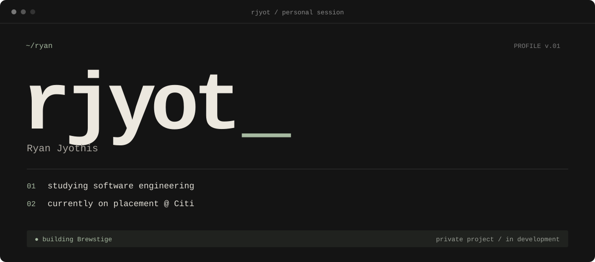

<p align="center">
  
</p>

<p align="center">
  <a href="https://github.com/rjyot">GITHUB ↗</a> &nbsp; / &nbsp;
  <a href="https://www.linkedin.com/in/ryanjyothis/">LINKEDIN ↗</a>
</p>

<br />

### `01` &nbsp; / &nbsp; about

I'm **Ryan**, a software engineering student currently on placement with **Citi**.

Outside placement, I'm building Brewstige. I enjoy the work between an idea and a usable product: shaping the interface, connecting the data, and working through the details that make the whole thing work.

<br />

### `02` &nbsp; / &nbsp; on the workbench

<table>
<tr>
<td>

#### BREWSTIGE &nbsp; <sub>PRIVATE / IN DEVELOPMENT</sub>

**A better way to find your next café in Belfast.**

A mobile app bringing café discovery, verified visits, and social profiles together.

The engineering behind it spans interactive maps, QR and location-based check-ins, server-side points validation, database access policies, and native Android builds.

<sub>REACT NATIVE &nbsp; / &nbsp; EXPO &nbsp; / &nbsp; TYPESCRIPT &nbsp; / &nbsp; SUPABASE &nbsp; / &nbsp; POSTGRESQL &nbsp; / &nbsp; MAPLIBRE</sub>

</td>
</tr>
</table>

<br />

### `03` &nbsp; / &nbsp; current toolkit

```text
interface    TypeScript · React · React Native
mobile       Expo · Expo Router · NativeWind
backend      Supabase · PostgreSQL
maps         MapLibre
```

<br />

---

<code>ryan@github:~ $</code> &nbsp; [let's connect ↗](https://www.linkedin.com/in/ryanjyothis/)
