<a name="top"></a>
<!-- rjyot · profile README · monochrome: #0D1117 · #30363D · #8B949E · #F0F6FC · accent #58A6FF -->

<picture>
  <source media="(prefers-color-scheme: dark)" srcset="./assets/profile-terminal-dark.svg" />
  <source media="(prefers-color-scheme: light)" srcset="./assets/profile-terminal-light.svg" />
  
</picture>

<p align="center">
  
</p>

<p align="center">
  
  
  <br />
  
  
  
</p>

<p align="center">
  <a href="https://www.linkedin.com/in/ryanjyothis/"></a>
  <a href="https://www.instagram.com/ryanjyothis/"></a>
  &nbsp;
  
  &nbsp;
  
</p>

---

<h2 align="center">01 &nbsp;·&nbsp; A B O U T</h2>

Integrated MEng Software Engineering student at **Queen's University Belfast** (2024 – 2029), currently working as a **Technology Placement Analyst at Citi**.

The part of software I enjoy most is the space between an idea and a usable product: shaping the interface, connecting the data, and getting the small details right so the whole thing actually works.

Looking for **summer 2027 software engineering internships** in the **UK and Ireland**.

---

<h2 align="center">02 &nbsp;·&nbsp; T E C H &nbsp; S T A C K</h2>

<table align="center">
<tr>
<th>Language</th>
<th>Frontend</th>
<th>Mobile</th>
</tr>
<tr>
<td align="center"><br /><sub>TypeScript</sub></td>
<td align="center"><br /><sub>React · React Native</sub></td>
<td align="center"><br /><sub>Expo · Expo Router · NativeWind · Android</sub></td>
</tr>
<tr>
<th>Backend</th>
<th>Database</th>
<th>Maps</th>
</tr>
<tr>
<td align="center"><br /><sub>Supabase</sub></td>
<td align="center"><br /><sub>PostgreSQL</sub></td>
<td align="center"><br /><sub>MapLibre</sub></td>
</tr>
</table>

<p align="center">
  
  
  
  
  
  
  
  
  
</p>

---

<h2 align="center">03 &nbsp;·&nbsp; E X P E R I E N C E &nbsp; &amp; &nbsp; E D U C A T I O N</h2>

<table>
<tr>
<td width="50%" valign="top" align="center">


### Citi
**Technology Placement Analyst**

</td>
<td width="50%" valign="top" align="center">


### Queen's University Belfast
**MEng Software Engineering** · integrated master's

<sub>2024 – 2029</sub>

</td>
</tr>
</table>

```diff
+ MEng Software Engineering @ Queen's University Belfast (2024 – 2029)
+ Technology Placement Analyst @ Citi
+ 2nd overall at Hack Belfast
+ built Zeto at the Notion × Dublin AI Week Student Hackathon (Oct 2026)
+ looking for summer 2027 SWE internships in the UK & Ireland
```

---

<h2 align="center">04 &nbsp;·&nbsp; A C H I E V E M E N T S &nbsp; &amp; &nbsp; P R O J E C T S</h2>

<div align="center">

| Event | Result | Project |
|:--|:--|:--|
| **Hack Belfast** · 24-hour hackathon | 🏆 2nd overall · 5-person team | Brewstige |
| **Notion × Dublin AI Week Student Hackathon** · Oct 2026 | Participant | Zeto · private repo · TypeScript |

</div>

---

<h2 align="center">05 &nbsp;·&nbsp; G I T H U B &nbsp; S T A T S</h2>

<table align="center">
<tr>
<td align="center" valign="top">

</td>
<td align="center" valign="top">

</td>
</tr>
<tr>
<td colspan="2" align="center" valign="top">
<!-- TODO: re-add the top-languages card once there are public repos with code (it currently says "No languages data"):

-->

</td>
</tr>
<tr>
<td colspan="2" align="center">

</td>
</tr>
</table>


<p align="center">
  
</p>

<!-- the snake appears once .github/workflows/snake.yml has run and created the output branch -->
<picture>
  <source media="(prefers-color-scheme: dark)" srcset="https://raw.githubusercontent.com/rjyot/rjyot/output/github-contribution-grid-snake-dark.svg" />
  <source media="(prefers-color-scheme: light)" srcset="https://raw.githubusercontent.com/rjyot/rjyot/output/github-contribution-grid-snake.svg" />
  
</picture>

---

<h2 align="center">06 &nbsp;·&nbsp; C O N T A C T</h2>

<p align="center">
  Hiring for <b>summer 2027</b> software engineering internships in the UK or Ireland?<br />
  Get in touch on LinkedIn or Instagram.
</p>

<p align="center">
  <a href="https://www.linkedin.com/in/ryanjyothis/"></a>
  <a href="https://www.instagram.com/ryanjyothis/"></a>
</p>

<p align="center"><a href="#top"><sub>↑ back to top</sub></a></p>
